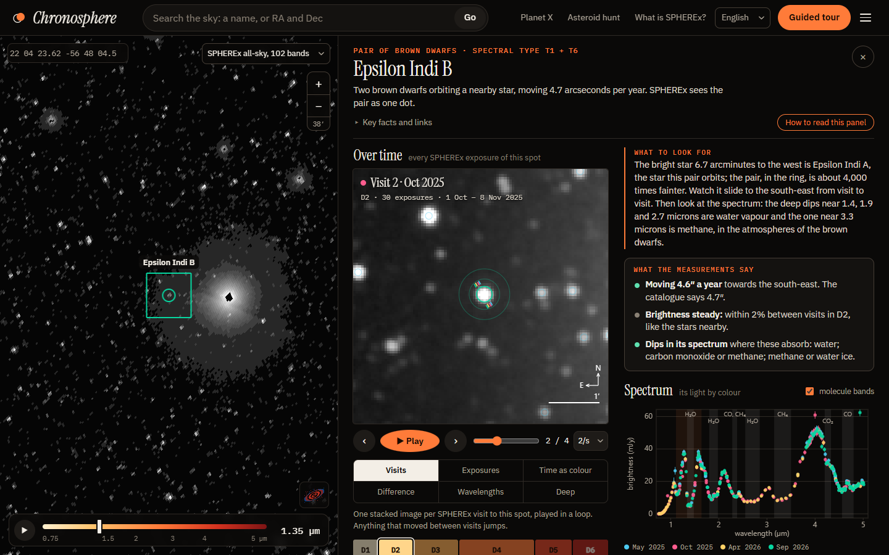

# Chronosphere

**Explore the changing infrared sky.** Fly over the whole sky as NASA's SPHEREx mission sees it, click
anything, and watch that spot change over time. Chronosphere tells you what the object is, plays every SPHEREx
exposure of it like a little video so that motion and brightness changes stand out, builds its 102-band
spectrum on the spot, and checks whether what you see is real.

Live: https://chronospherex.com/ · guided tour: add `?tour` · an asteroid hunt: add `?hunt`

Seven slides about it: https://chronospherex.com/chronosphere-slides.pdf



Built during the 2026 NASA Space Apps Challenge (challenge: *Planet X and SPHEREx*) by team The Bright Nobles.

## What you can do

- **See it move before you press anything.** The front page says that the sky is not still, and shows it:
  beside the title Pluto walks across a patch of sky in 17 real SPHEREx pictures (3 to 12 October 2025), the
  ring on it and the stars standing still. The pictures are the tool's own "Passing body" view of Pluto,
  saved from the page itself; a press opens Pluto in the tool. People who asked their device for less motion
  get one still picture.
- **Roam the sky.** The map is the SPHEREx all-sky data cube served by NASA/IPAC, shown with Aladin Lite. A
  slider moves through all 102 wavelengths; 2MASS, WISE and visible-light maps are one click away. A new
  colour, a new place or a new zoom dissolves in as a whole: the map never flashes or shows half-loaded sky.
  The sky is on screen in under half a second, also on a first visit: a still picture of the opening view
  comes with the site, and the live map dissolves in over it.
- **Click any object, or search by name or coordinates.** The map dives there. The object is identified
  through SIMBAD (type, spectral type, distance, proper motion), with a Wikipedia card when one exists. A
  click picks the brightest catalogued object within a few screen pixels, so the star you aimed at is the one
  that opens, even in the most crowded parts of the Milky Way; a click anywhere on the glare of a bright star
  opens that star, not a faint one drowned in it. The map then shows the object from close by (a view 37
  arcminutes wide around the 5-arcminute field of the images), and stays closer if you had zoomed in further.
  Catalogue coordinates of a nearby star point at where it was in the year 2000: the tool notices, says
  how far the star has moved since, and takes you to where it is now.
- **Get the answer first.** The panel opens with *What the measurements say*: a few plain sentences on
  whether the spot moved, whether its brightness changed and which molecule bands show, written from the
  same numbers as the detailed sections below them. Only what is beyond doubt is stated plainly.
  The story comes first: under the name stand one sentence on what the object is, what to look for, and the
  pictures. Where it is, how far, how many exposures there are and the links to other observatories' tools
  are folded under the name (*Key facts and links*), one press away. If the spot you ringed is where an
  asteroid stood at one stop of the telescope, the first line says so (*The light in the ring: (110) Lydia,
  which passed through this very spot on …*), and a press follows the asteroid. While a field read live is
  still being searched for passing bodies, which takes minutes when it is wide, the panel says that it is
  still looking, and then what came of it.
- **Watch it over time.** Every SPHEREx exposure covering the spot is read, aligned and played back.
  *Visits* stacks each SPHEREx visit and loops through them, *Time as colour* paints early red and late blue,
  *Difference* subtracts visits, *Wavelengths* steps through the six detectors.
- **Did it move?** For any spot you click, its position is measured in every visit and compared with how
  well ordinary stars in the same images repeat. A catalogued fast mover is also set against its predicted path.
- **Did it change?** Brightness changes between visits are checked against ordinary stars in the same images:
  if they stayed steady and the spot did not, the change is in the sky and not in the camera.
- **What else is going on here?** Every clear star in the field is tested the same way, without using any
  catalogue, and the few that moved or changed are listed and marked. On the test fields this blind check
  finds Barnard's Star (10.5 arcseconds north), Epsilon Indi B (6.1 arcseconds south-east) and the fading of
  RW Aurigae, and nothing else.
- **What passed through?** Every exposure of the field is also searched for bodies of the solar system: dots
  that are at one place for a few minutes, in several exposures, and gone from there on other days. SPHEREx
  stops, takes up to four exposures two minutes apart, and looks at each place with two of its detectors at
  once, so a real body is in several independent images where a cosmic-ray hit is in one. Each body found is
  named through SkyBoT (IMCCE, Paris Observatory) and can be followed from stop to stop: the ring goes with
  it, the images show it moving against the stars, and its own spectrum is built. In the field that Pluto
  crossed in October 2025 the search finds Pluto and two main-belt asteroids, (6747) Ozegahara and
  (1218) Aster.
- **Find an asteroid.** Three ways. *Find an asteroid*, on the front page, takes one of the first three
  thousand numbered asteroids at random, finds a patch of sky it crossed while SPHEREx was looking (its orbit
  from Miriade, IMCCE; the exposures from the sky index) and opens it without telling the search which
  asteroid it is or where it was. About three hundred exposures are read, the panel says what is being done
  and then what was found, and the find is shown at once, moving from stop to stop. Or type a body's name or
  number into the search box (Ceres, 433 Eros, Uranus, 2P/Encke; also Plüton, Urano, Cérès): the days on which
  SPHEREx had it in view are listed, and the patch of sky it crossed opens with the ring on it. Typed
  *Uranus*, the page opens the planet's field of February 2026, and its search finds, unasked, the moons
  Titania and Oberon circling it. Or open any place: its exposures are searched all the same.
- **And when one is found?** A catalogued body is nothing to report; what is new is what SPHEREx measured of
  it, and that can be saved: its spectrum as a table, and its measured places as a report in the Minor Planet
  Center's ADES format, with SPHEREx's observatory code (288) and, for every exposure, where the spacecraft
  was, read from the exposure's own header. A dot that SkyBoT cannot name gets three steps instead: look at
  it in the single exposures, ask the Minor Planet Center's own MPChecker (one link, with the place and the
  moment filled in), and only then the report file. The page *Asteroid hunt*, in six languages, says how to
  find one, what is to be had, and where and how a find is reported; it says first that a discovery is not
  to be expected, because bodies as bright as SPHEREx can see were catalogued long ago.
- **Is it real, or the camera?** Every exposure carries the processing pipeline's own flags for each pixel:
  cosmic-ray hits, overloaded pixels, left-over charge, reflections of bright stars, and more. In the
  *Exposures* view, "This image" reads them on request (a few hundred kilobytes), says which are set at the
  circled spot, lists those present in the field with the share of its pixels, and draws the pixels of the one
  you press on the image. The names and their meaning are read from the file itself, so a flag added by a
  later data release appears without a change to the site.
- **What is it made of?** Click a star to get its spectrum from 0.75 to 5 microns and a table of the dips
  found where water, methane, carbon monoxide and carbon dioxide absorb. A body of the solar system shines
  by reflected sunlight: its measurements are divided by the Sun's spectrum and checked for the bands of
  methane ice instead. Pluto shows them: 40 per cent at 1.3 to 1.4 microns, 47 at 2.2 to 2.4, 57 at 3.2 to 3.6.
- **Check it elsewhere.** One click opens the same coordinates in SIMBAD, WiseView (Backyard Worlds), ESASky,
  the Legacy Survey viewer and the VizieR photometry viewer. A body of the solar system links to its orbit
  at NASA/JPL and at the Minor Planet Center.
- **Take it with you.** Copy a link to the exact view, save the image or a video of the sequence, or download
  every measurement as a CSV file.
- **Take the guided tour.** Thirteen short steps, in plain language, from "what is SPHEREx" through the five
  test objects of the challenge to Pluto. One step shows two real SPHEREx pictures of the same patch of sky,
  six days apart, flipping the way Clyde Tombaugh flipped his plates: one dot moves, and it is Pluto. The
  last object is Pluto in the tool itself, found by its own search. Two steps are about Planet X:
  what was predicted and why, that nobody has seen it, and a ladder of brightness from Sirius down to the
  prediction that shows what a magnitude is and why a single SPHEREx exposure stops about 16 to 250 times
  short of it. At the first object, numbered pointers lead from the tour's card to the parts of the panel,
  and Next walks through the panel before the tour moves on. The tour is saved on the device and runs
  without a connection; the four further objects its last step offers are read live from the archive, and
  one press keeps those too. With a connection the last step also offers a hunt.
- **Learn the panel.** "How to read this panel", on every object, walks through its nine parts one at a time:
  the part is lit, the rest dimmed, and a card says what it shows and what can be done with it. The tour
  takes the same walk at its first object.
- **In six languages.** The front page, the guided tour, the walk through the panel, the measurement panel
  itself with the sentences it writes from the numbers, and the four information pages are in English,
  Turkish, Spanish, German, French and Polish (the picker is in the top bar; `?lang=tr` in an address does
  the same). Dates, counted nouns and the encyclopedia card follow the language. The words live in
  `web/js/lang.js` and in one file per language under `web/js/lang/` and `web/js/pages/`: adding a language
  is translating those three. Every kind of object that SIMBAD knows (226 of them, from *Star* to *Gravitationally
  Lensed Image of a Quasar*) has its name in each language. Spanish speakers who tried the site reported words
  left in English; the German, French and Polish texts have not yet been read by a native speaker.

## How the challenge is covered

| Challenge request | In Chronosphere |
|---|---|
| Public web tool | A static site with no server and no login; works on a phone and offline |
| Enter RA and Dec | Decimal degrees, sexagesimal, or an object name; or just click the map. Coordinates can be pasted with their labels, as the challenge text gives them ("Right Ascension 08h55m10.831s, declination -7d14m42.53s"); for old coordinates of a fast mover the tool offers to jump to where the object is now |
| Series of images like a little video | Starts playing by itself; pause, step, speed; zoom and pan |
| Easy to spot moving objects | Visit stacks, time-as-colour, difference images; every clear star in the field is checked for motion and flagged; the shift of any clicked spot is measured and judged against ordinary stars; catalogued movers are compared with their prediction |
| Tested on Barnard's Star, Epsilon Indi B, WISE 0855, RW Aurigae, R Draconis | On the front page and in the guided tour, each with a note on what to look for |
| Easy to update with new data releases | Nothing about releases is hard-coded: a scheduled job rebuilds the sky index from the archive, and each release can be switched on or off in the viewer |
| Use the 102 bands, add detectors, spectra on the fly | Per-detector stacks; the 102-band all-sky map; click-to-spectrum computed in the browser |
| Add or subtract images from different times | Visits, Deep sum and Difference modes |
| Choose the field of view | 3 to 40 arcminutes |
| Overlay other telescopes | Gaia DR3 with proper-motion arrows and WISE sources, for any position; 2MASS, WISE and DSS sky maps |
| Coordinates in the URL | `?ra=269.446&dec=4.771&fov=5&det=5&mode=epochs`; add `&embed=1` for a bare viewer to place in an iframe; `?tour` starts the tour, `?hunt` a hunt, `?sso=Ceres` opens a body of the solar system by name |
| Display metadata | Date, wavelength, detector, release, exposure id, sky level, noise, coverage, PSF width, masked pixels, the pipeline's flags for each pixel by name (cosmic-ray hit, overflow, persistence, ghost and the rest, read from the file's FLAGS layer and drawn on the image) and a link to the source FITS file for every exposure |

## How it works

Chronosphere has **no server**. The site is a set of static files; everything else is the visitor's browser
talking directly to NASA's open data.

1. **Sky index.** `web/index/` is a compact index of every public SPHEREx exposure (about 1.6 million): where
   each one was pointed, when, with which detector, and where its file lives. A weekly workflow asks the
   NASA/IPAC archive how many exposures each release holds and downloads only releases that are new or have
   grown, so new data appears without touching the code. If the archive is unreachable or the numbers do not
   add up, nothing is written.
2. **Read only what is needed.** For each exposure near the chosen position, the browser reads the FITS header
   and a small block of pixels around the target with HTTP range requests from the public `nasa-irsa-spherex`
   bucket: a few hundred kilobytes instead of a 63 MB file.
3. **Align.** Each block is resampled onto one common north-up grid using the exposure's own astrometry
   (TAN-SIP), and the local sky level is removed.
4. **Wavelength.** SPHEREx has no filter wheel. A linear variable filter means every pixel of every exposure
   sees a slightly different wavelength; the per-pixel wavelength is read from the `WCS-WAVE` table in each
   file. That is why stepping through time also builds a spectrum.
5. **Compute on the device.** Stretching, stacking, differencing, colour compositing, photometry, spectra, band
   depths, brightness curves and the checks against comparison stars are all computed in the browser.
6. **Identify with today's positions.** Catalogues store where a star was in the year 2000. Nearby stars have
   moved since (Barnard's Star by about 280 arcseconds), so a plain coordinate search misses them. Chronosphere
   also fetches fast movers in a wider area and moves every candidate to today's date before matching.
7. **Offline.** A service worker keeps the page, the five showcase objects, the sky-map tiles of the guided
   tour, every other tile already seen and every position already opened on the device. Each release of the
   site is stored as one set, so a poor connection can never mix new files with old ones. A moving star's
   place "today" is worked out for the middle of the current month, so that what is kept for a position is
   found again all month (the price: under half an arcsecond for the star with the largest proper motion in the sky).
8. **No flashes.** The map library repaints from nothing when its picture changes: a new colour of the cube
   is blank white until its tiles arrive, and a new place starts as empty sky. So every such change is made
   behind a still copy of the map (`web/js/sky.js`). The copy starts moving with the click, towards the
   destination; the site follows each of the library's tile requests, and the copy dissolves into the new
   picture when that picture is complete. Tiles are fetched ahead of the change, so a slow connection delays
   the change instead of showing it half done.
9. **A sky at once, and no holes.** The archive needs several seconds to deliver the first view: one to
   three dozen tiles of about 200 kB each. A still picture of exactly that view (`web/opening.jpg`, a copy
   of the map's own canvas, made by pointing the map at a square that holds the opening view of a screen of
   any shape) is shown at once and is clickable; the live map replaces it when complete. The archive also
   breaks off tile downloads that have queued for about ten seconds, and the map library does not ask
   again. The site reads every tile to its end to notice this, fetches a broken one once more, and then,
   still behind the still picture and only once the library has no request of its own under way, starts the
   layer afresh: the library finds every tile in the browser's store, and no hole stays.

## How the numbers were checked

- **The browser reader** (`web/js/archive.js`) against an independent Python implementation built on Astropy
  (`backend/spherex.py`): same pixel positions, wavelengths and sky levels, and images that agree to a small
  fraction of the noise.
- **Motion.** Every moving target is measured independently in each detector that sees it. Barnard's Star:
  10.4 arcseconds per year in two detectors, catalogue 10.4. Epsilon Indi B: 4.6 in all six detectors,
  catalogue 4.7. WISE 0855, faint and with only half a year between its two detections: 7.0, catalogue 8.2.
  Ordinary stars in the same images stay put to within 0.3 arcseconds.
- **Parallax.** Predictions include the yearly wobble of nearby stars; the formula agrees with Astropy to
  0.004 arcseconds. With it, Epsilon Indi B lands within 0.1 to 0.3 arcseconds of its prediction in every
  visit, and Barnard's half-arcsecond east-west swing shows up in the data.
- **Brightness.** Ordinary stars in the same images repeat to 1 or 2 per cent from visit to visit. Against
  that, RW Aurigae brightened by more than 40 per cent below 1.6 microns and faded by almost half beyond
  3.8 microns within a year.
- **Flux scale.** Aperture fluxes of ordinary stars come out 10 to 15 per cent below their 2MASS values,
  as expected for a 9-arcsecond aperture without aperture correction.
- **Saturated stars.** The halo of an overloaded star does not scale simply with its brightness, so halo
  measurements are joined to the neighbouring detector rather than converted with a fixed factor. For
  Barnard's Star the joined spectrum lands within 15 per cent of 2MASS at H and K, and 40 per cent low at J.
- **Beyond the test objects.** Read live from the archive, with no preparation: Teegarden's Star and
  Luhman 16 are measured moving at 5.3 and 2.8 arcseconds per year, against catalogue values of 5.1 and 2.8.
  The blind field check finds Luhman 16 from raw coordinates, and rejects a close pair of stars in the same
  field that a naive position comparison would report as moving.
- **Passing bodies.** The search was run on sixteen fields (17 and 18 November 2026). In eight fields of 10
  arcminutes along the ecliptic it reported 20 bodies: SkyBoT lists a catalogued body within 3 arcseconds of
  every one of them (visual magnitudes 14.0 to 18.8), and nothing was reported that it does not list. In
  three fields of 5 arcminutes at ecliptic latitudes of 17, 29 and 52 degrees it reported none, and none in
  the fields of the five test objects.
  Six of the eight fields were centred on a body known to be there: Pluto was found at all 19 stops of the
  telescope that caught it, about half an arcsecond from the path JPL computes; (1467) Mashona (magnitude
  14.0) at 3 of 3, (5379) Abehiroshi (17.2) at 4 of 4, (13232) Prabhakar (17.6) at 1 of 2, (19694) Dunkelman
  (18.4) at 1 of 4, and (6563) Steinheim (18.6) at neither of 2: the search reaches about magnitude 18.
  The other two were picked by the hunt itself, and the search was not told what to expect: it found
  (1292) Luce (15.9) at 5 of 5 stops and (716) Berkeley (16.4) at 2 of 3, and beside them four fainter
  bodies, of magnitude 17.8 to 18.7. A third hunt, started from the front page's button, picked
  (1824) Haworth (16.4) near the point where its path turns back, read 264 exposures in 101 seconds and found
  it at 12 stops over a week.
  And one came from a visitor's question: at right ascension 330.43659°, declination −19.17837° a light
  stood in one visit and was gone in the others. The search had found (110) Lydia (magnitude 12.5) at 4
  stops on 4 and 5 November 2025, and at the third it stood 2.6 arcseconds from the ringed spot; the panel
  said so for the field but not for the ring, which is why it now does.
  Speeds measured from the tracks agree with the orbits: 21.0 against 20.8 arcseconds an hour for Ozegahara,
  23.5 against 23.6 for Aster, 17.3 against 16.9 for Luce. What was turned away on the way: charge left in a
  detector by a bright star (missing from the first exposure of every stop, and back at the same place at
  every stop of a visit), cosmic-ray hits that fell on one place twice, which the pipeline's own flags mark,
  faint stars that show only at one end of a detector's range of wavelengths, which are there again whenever
  the telescope returns in that colour, and dots that are in one of the two long-wavelength detectors only:
  sunlight thrown back is brighter at the short end, where the test bodies stand out two to five times more
  clearly, so a dot that is strongest in D5 or D6 while the partner detector shows less than half as much is
  a fault of that detector (one such dot, which SkyBoT and the Minor Planet Center's checker both did not
  know, was reported in a field before this rule). A body in front of a faint star used to be passed over;
  now a strong dot there counts in a second round, under stricter rules (three images, two of them in one
  detector, and next to nothing at that place on other days): Berkeley's second stop is found this way, and
  the sixteen fields give the same bodies as before otherwise. Seven more fields, opened by name the same
  day, gave the body asked for each time and six others, every one catalogued. One of them first showed a
  second dot that no catalogue knew: a faint source that is there in three of eight exposures of the same
  colour at other times. The test in the same colour now turns a dot away at a third of them, when that is
  three exposures or more, where it took half; among the test bodies that share never passes 29 per cent.
  Uranus, opened by name, is found at 13 of the 14 stops that caught it, 0.4 arcseconds from its path, and
  with it Titania (magnitude 14.2) at 12 stops and Oberon (14.4) at 10, which SkyBoT names. A moon circles
  its planet and a slow asteroid turns back, so the search, which joins what moves in a straight line, finds
  such a body in pieces: pieces that SkyBoT gives one name are shown as one body.
- **Bodies by name, and where the spacecraft was.** A path computed for the centre of the Earth is not where
  SPHEREx sees a body: from 650 km up, a main-belt asteroid lies a few arcseconds to the side. Every exposure
  gives the position of the spacecraft in its header (X_SC, Y_SC, Z_SC, with GEOCENTER as origin; the axes
  are not named). Read as the equatorial axes of the star positions and turned by the Earth's rotation, that
  position falls within a degree of the ground track the same header gives, in twelve exposures spread over
  the mission; what remains in longitude, 0.32 degrees on average, is the precession since the year 2000
  (0.33 degrees), as it should be for axes fixed to the stars.
  Shifting a body's path by that position brings it onto the dots the search found. For seven bodies opened
  by name (155 exposures) the dots lie a median 1.16 arcseconds from the path as the centre of the Earth sees
  it, and 0.80 from the path as the spacecraft sees it. It matters most where the shift is large: (1292) Luce,
  1.96 au away, 2.30 against 0.62; (1467) Mashona, 2.47 au, 2.01 against 0.81; (433) Eros, 1.15 au, 2.10
  against 0.86. For Pluto, 35 au away, the shift is a tenth of an arcsecond and changes nothing (0.85 and
  0.81). What is left, about 0.8 arcseconds, is how well a dot can be placed on images resampled from pixels
  of 6.15 arcseconds; the reports state 0.7 arcseconds in each coordinate for a clear dot, more for a faint one.
- **Picking a field for a hunt.** Twelve picks in a row: eleven gave a field, after one to six asteroids
  tried and 1 to 10 seconds; one gave none (ten asteroids are tried now, where six were). The two fields then
  read in full are the two hunts above.
- **Names.** Sixteen names typed into the search box: "Sirius", "Vega", "Mira" (a star, and asteroid 3633),
  "61 Cygni" (a star; asteroid 61 is Danaë), "Proxima Centauri", "M31" and "Luhman 16" open the star or
  galaxy; "Ceres", "433 Eros", "(1467) Mashona", "asteroid Iris", "Uranüs", "2P/Encke" and "Vesta" open the
  body; "Apophis", which SPHEREx has not had in view, and a word that is no name are answered in words. The
  23 ways of writing coordinates and the 25 names that must stay names give the same result as before.
- **The report file.** The files the page writes for a numbered body, a provisional designation, a comet
  and a dot without a name were put through the IAU's own checker (the `iau-ades` package, `valsubmit`,
  against the schema for submissions): all pass. Its first try did not: a line of comment may hold a
  hundred characters. None of these files has been sent to the Minor Planet Center.
- **Pixel flags.** The FLAGS layer of an exposure is a Rice-compressed image; the page has its own decoder.
  For two whole exposures (4.16 million pixels each) its output is identical to Astropy's, pixel for pixel.
  For the stamps of three test objects, the flags the page assigns to each pixel were recomputed
  independently, with Astropy's decompression and Astropy's WCS including the SIP distortion: 0 of 28,812
  pixels differ. Edge, WebKit and Firefox give the same flags for the same exposure. The flags make sense where the answer is known: in the exposures tried, Barnard's Star and
  R Draconis, which overload the detectors, carry OVERFLOW and BLOOM at the circled spot, and WISE 0855
  carries no fault.
- **Sky-map tiles.** The HEALPix code (`web/js/healpix.js`) agrees with `astropy-healpix`, and the tiles it
  predicts for a view include the ones the map goes on to request.
- **Map transitions.** The guided tour was filmed frame by frame (about 5,300 frames for the twelve steps
  and the walk through the panel) and every frame measured: none is blown out to white or washed out, where
  each change of colour used to flash white. A probe inside the page then watched some 35,000 frames while the tour was stepped through at
  awkward moments (forwards and back in the middle of a change of colour or of place): the blank map was
  never in view. Moving to an object takes about one second.
- **First visit.** With nothing stored, on eight screen shapes from a small phone to an ultra-wide monitor:
  the still picture is up 0.4 s after the page starts to load and lies within one pixel of the live map
  that replaces it 4 to 14 s later, at the same brightness. Before, the map stayed dark for that time. A
  visitor who does not wait (clicks a star, starts the tour, drags, zooms, or arrives by a link to an
  object) never sees the blank map either. Tile downloads were then made to fail the way the archive
  fails them (refused at once, or broken off part-way, early or late, with the other tiles fast or slow):
  in 21 runs the live map matched the still picture each time. Without the repair the holes stay; an
  earlier form of the repair, which did not wait for the library to be idle, left the map scrambled in one
  run of four.
- **Nothing jumps while the page loads.** The browser's own measure of how far things on the screen move
  after they first appear (cumulative layout shift; 0.1 is the usual limit for "good") was 0.13 on a phone,
  0.23 on a small phone and 0.07 on a laptop, because the list of test objects and the map chooser were
  filled in after the first picture. Now: 0.01, 0.02 and 0.004 on the published site.
- **Languages.** Making the panel translatable must not change its English: the words of the panel for the
  five test objects, in six views each, were recorded before and after and are identical. A test language
  (`?lang=xx`) puts every translatable text in brackets; what stays outside them on the screen is object
  names, dates and the encyclopedia text. In each of the five other languages the panel was checked at laptop
  and phone size for text that spills out of its box (none in 50 views), and the Turkish and the Spanish tour
  were run from start to end with the network cut. The information pages have the same build in every
  language as in English (headings, paragraphs, list items, links), and the top bar holds at nine widths.
  After Spanish speakers reported words left in English, the whole site was walked once in English and once
  in Spanish (front page, menu, the five information pages, the tour with the walk through the panel, the six
  showcase objects in every way of comparing) and every text read the same in both was listed: names and
  units apart, one name on the tour's last step. Two more kinds of leftover could not be seen that way and
  were found by looking at pictures of the Spanish pages and by opening places read live: the two axis labels
  of the brightness plot, which are drawn on a canvas, and 183 of SIMBAD's 226 kinds of object ("Eclipsing
  Binary Candidate"), which only show when a visitor presses something uncommon. All are translated now.
- **The front page on small screens.** With the moving picture added, the front page was photographed on
  eleven screens (from 1920 by 1080 down to a 360 by 640 phone, and a phone held sideways) in each of the six
  languages, and measured: nothing lies over anything else, nothing is cut off at the top of the map, no
  button's words are clipped (0 faults in 66 views). On a short phone screen the sentence under the picture
  steps aside first, then the picture; before, the German and French titles were cut off at the top there.
- **Typed coordinates.** 23 ways of writing the same position (degrees, hours and minutes, with colons,
  with unit letters, with a typeset minus sign, with "RA" and "Dec" or the full words in any of the six
  languages) all give the position to 0.7 arcseconds or better, and none of 25 object names is mistaken for
  coordinates. The challenge's own coordinates for WISE 0855, pasted as written, open that spot and offer the
  jump to where the brown dwarf is today, 2.2 arcminutes away.
- **Clicks.** Ten well-known stars were clicked dead on and a few arcseconds off, at the tolerance of a wide
  map and of a close view, in empty and in crowded fields: 40 of 40 clicks opened the star that was clicked.
  The earlier catalogue query, which did not ask for the nearest objects first, managed 32.
  On a wide map a pixel is 20 to 25 arcseconds, so a click three or four pixels off a bright star is a minute
  or more of arc away from it. A bright star's reach therefore grows with its brightness: such clicks open
  the star in 30 of 30 tries on ten bright stars, Eta Carinae inside its cluster among them (18 of 30
  before).
  In the SPHEREx pictures a bright star is a disc of glare, about an arcminute across for Antares: at any
  zoom, a click inside it opens the star (6 of 6 at 30 arcseconds from the centre), a click 110 arcseconds
  away does not (12 of 12), and typed coordinates inside the glare are never renamed to the star (6 of 6).
  The catalogue is asked for the bright objects within reach without sorting them: sorted, the same question
  takes it a quarter of a minute in a crowded field.
- **Planet X.** What the tour says about the hypothetical planet is NASA's account of it ("Hypothetical
  Planet X", science.nasa.gov): 5 to 10 Earth masses, 20 to 30 times farther from the Sun than Neptune,
  10,000 to 20,000 years per orbit, not yet seen. The ladder of brightness uses Sirius at magnitude -1.46,
  the naked-eye limit 6, Barnard's Star 9.5 (SIMBAD), Pluto 15.1 at mean opposition (NASA fact sheet), a
  single SPHEREx exposure at about AB 19 (5 sigma in one band; the mission's sky-simulator paper, 2025), and
  Planet X at visual magnitude 22 to 25 (Brown & Batygin 2016), with wide searches complete to about 21
  (Brown, Holman & Batygin 2024). The "times fainter" between rungs is 10^(0.4 x the difference in
  magnitude), rounded.
- **Catalogue facts** shown for the five test objects are curated with their sources: Gaia DR3 parallaxes
  and proper motions, and Kirkpatrick et al. 2021 for WISE 0855. A distance is only shown when the parallax
  is measured to better than 20 per cent.

## Run it

Any static file server will do:

```
cd web
python -m http.server 8000
```

Open http://localhost:8000.

### Maintenance scripts (Python)

```
python -m venv .venv
.venv/Scripts/pip install -r requirements.txt        # Windows; use .venv/bin/pip elsewhere
.venv/Scripts/python scripts/build_index.py          # bring the sky index up to date (downloads only what is new)
.venv/Scripts/python scripts/prebuild.py             # rebuild the five showcase objects
.venv/Scripts/python scripts/prebuild.py --meta      # refresh only their descriptions and catalogue facts
node scripts/build_body.mjs pluto                    # rebuild Pluto: its path from JPL Horizons, its field from the archive
```

The `backend/` folder also contains an optional FastAPI service with the same pipeline in Python
(`python -m uvicorn server:app --app-dir backend`); the site does not need it.

## Layout

```
web/index.html        the page itself: the map, the search box and the measurement panel
web/sunum.html        a seven-scene cinematic presentation of the project with speaker notes, in Turkish and English
web/chronosphere-slides.pdf   the seven-slide demonstration handed in with the project
web/config.js         the address of the optional Python API (empty by default: the site needs no server)
web/css/              style.css (the page) and fonts.css (the self-hosted fonts)
web/js/archive.js     sky index lookup, FITS range reader, TAN-SIP astrometry, resampling, wavelength
web/js/app.js         viewer, plots, search, checks against comparison stars, tour wiring, offline store
web/js/core.js        decoding, sky geometry, stacking, photometry, band depths, joining saturated detectors
web/js/plot.js        the scatter plots on a canvas: axes, error bars, hover tooltip, click to select
web/js/sky.js         the explorable sky map (Aladin Lite + IRSA sky maps)
web/js/rice.js        Rice decompression, for the flags layer of an exposure
web/js/healpix.js     which sky-map tiles a view needs (HEALPix)
web/js/movers.js      bodies of the solar system passing through a field: the dots that are not always there
web/js/bodies.js      a body by name: its path (Miriade), the days SPHEREx had it in view, the shift to where the
                      spacecraft was, the report in the Minor Planet Center's format, a field for a hunt
web/js/info.js        identification (SIMBAD), names of solar-system bodies (SkyBoT), Wikipedia card, links to other tools
web/js/tour.js        guided tour: the steps and what the map does at each
web/js/lang.js        the words of the front page, the tour and the walk through the panel, in six languages
web/js/lang/          the measurement panel in Turkish, Spanish, German, French and Polish (one file each)
web/js/pages.js       the "Asteroid hunt", "What is SPHEREx?", "How it works" and "About" pages, in English
web/js/pages/         the same four pages in the other five languages (one file each)
web/hero-pluto.webp   the front page's moving picture: the tool's own "Passing body" view of Pluto (hero-pluto.jpg: one still frame)
web/sw.js             service worker: offline cache
web/404.html          what a wrong address shows, with the way back to the map
web/manifest.webmanifest, web/icon-192.png, web/icon-512.png, web/apple-touch-icon.png, web/favicon.ico
                      the site's name and icon for home screens and browser tabs
web/find-asteroids.html, web/what-is-spherex.html, web/how-it-works.html, web/about.html
                      the four information pages as plain pages with addresses of their own, which a search
                      engine or a browser without scripts can read (generated)
web/planet-x.html     Planet X, Pluto and SPHEREx: the guided tour's story as a plain page, with Pluto in two
                      SPHEREx exposures six days apart (generated)
web/barnards-star.html, web/epsilon-indi-b.html, web/wise-0855.html, web/rw-aurigae.html, web/r-draconis.html
                      the five test objects as plain pages, each with its SPHEREx pictures (generated)
web/pluto.html        Pluto as a plain page: one SPHEREx picture for every stop of the telescope that caught it (generated)
web/tr/, web/es/, web/de/, web/fr/, web/pl/   the same pages in the other languages (generated)
web/img/              those pictures: real SPHEREx images, made by scripts/build_images.py
web/robots.txt, web/sitemap.xml   for search engines (the sitemap is generated with the pages)
web/db83ba526cb561c174feda741610f139.txt   the IndexNow key: Bing, Yandex and others read it to check that a
                      notice of new pages (scripts/indexnow.py) comes from this site
web/index/            the sky index (generated)
web/data/             the showcase objects: the five test objects and Pluto (generated)
web/vendor/aladin.js  Aladin Lite 3.8.2 (CDS, GPL-3.0), unmodified
web/fonts/            IBM Plex and Instrument Serif (SIL Open Font License)
scripts/              build_index.py, prebuild.py; build_body.mjs builds Pluto with the site's own reader (Node);
                      build_pages.mjs writes the plain information pages
                      from web/js/pages.js, the tour's words and the showcase objects (run it with Node after
                      changing any of them); build_images.py makes their pictures from the showcase data;
                      indexnow.py tells search engines which pages changed
backend/              Python reference pipeline and optional API
```

No build step: plain HTML, CSS and JavaScript modules.

## Honest limits

- A SPHEREx pixel is 6.15 arcseconds. Even Barnard's Star moves only about 1.7 pixels per year, so motion shows
  up as a small shift between visits, not a streak. Positions repeat to a few tenths of an arcsecond, so
  anything slower than roughly one to two arcseconds per year cannot be seen yet.
- Each exposure is at a different wavelength, so single exposures of the same star differ in brightness for a
  physical reason. The brightness-over-time plot divides each measurement by the star's own average spectrum at
  that wavelength to separate real variability from colour.
- Photometry is a simple 9-arcsecond aperture without aperture correction, meant for exploring, not for
  publication. It reads roughly 10 to 15 per cent low.
- Very bright stars saturate the detectors. They are measured from their outer halo and each detector is
  joined to its neighbour: the overall shape of the spectrum is right, the level and the fine detail are
  approximate. If every detector is saturated only relative brightness is shown.
- Next to a very bright star, faint neighbours sit in its glow, so they cannot serve as comparison stars;
  the tool says so instead of comparing.
- Pixel flags are read for one exposure at a time and need a connection; the stacked views (Visits, Deep and
  the others) mix many exposures and show no flags of their own. A pixel of the displayed image takes the
  flags of the four detector pixels it was resampled from, so a flagged pixel reaches one pixel further than
  on the detector. The plain-language meaning given for each flag is ours; the file's own short description
  is used for any flag the site does not know.
- A dip at a molecule's wavelength is a hint, not a detection: other molecules and the shape of the spectrum
  itself can produce one.
- The search for passing bodies reaches about magnitude 18, and a body has to be caught at two moments of
  one stop, or by both detectors of a pair at one moment: fainter bodies and bodies in a single exposure are
  missed. In front of a star a body is found only when it is strong (15 times the noise, in three images),
  or where a track already leads to it. A body that shows in the two long-wavelength detectors only (the gas
  of a comet, a very dark and warm body) is turned away with the faults of those detectors. A sighting that
  is not part of a straight track of three stops is kept only after the pipeline's flags of its dots have been
  read, which needs a connection. SkyBoT's places, which name the bodies found, are computed for the centre of
  the Earth; seen from SPHEREx a main-belt asteroid lies up to a few arcseconds from there (the path of a body
  opened by name is shifted to where the spacecraft was; the comparison with SkyBoT is not). A dot that SkyBoT
  does not know can still be a fault of the image.
- A hunt reads about three hundred exposures, a few hundred megabytes, and takes two to four minutes; it
  needs the orbit service (Miriade) and the archive. Its field is picked for an asteroid of magnitude 16.5 or
  brighter that stayed in it for three stops of the telescope: of the two hunts read in full, one found its
  asteroid at all five stops and one at two of three. A hunt finds catalogued bodies: asteroids bright
  enough for a single SPHEREx exposure have been known for years.
- The places written into a report are centroids on images resampled to 3.1-arcsecond pixels from pixels of
  6.15: good to about 0.7 arcseconds for a clear dot, and stated as such in the file. The file is a draft in
  the right format, not a submission: the Minor Planet Center asks to be contacted before archival
  observations are sent, the reporter's name has to be put into it, and whether positions of this accuracy
  are wanted for a body it already knows is for the Center to say.
- A body opened by name is shown where it stayed inside one field for the most stops of the telescope; a
  fast one, such as a near-Earth asteroid, is caught at one or two. Planets and their moons are named, but
  not linked to an orbit page, and no report is written for them: the Minor Planet Center collects the
  positions of minor planets, comets and the far-out small moons, not of planets and their large moons. The
  brightest planets have not been tried.
- The ice bands of a body of the solar system are measured on its light divided by a black body of 5772 K
  standing in for the Sun, from the few exposures of one visit; the band beyond 3 microns is set against its
  short-wavelength side alone, because methane ice leaves no bright stretch on the other.
- A star close to saturating the camera is located less faithfully: Barnard's Star is 1.7 arcseconds off its
  prediction in its first visit in one detector, while its other visits agree to 0.2 to 0.4.
- The all-sky map is coarser (about 13 arcseconds per pixel) than the images loaded for a selected spot.
- Away from the five test objects, the number of exposures is an estimate until they have been read, and the
  WISE overlay is CatWISE2020 when the CDS catalogue service answers and AllWISE otherwise.
- The ladder of brightness sets visual magnitudes beside SPHEREx's infrared limit, which is on the AB scale.
  For a body that shines by reflected sunlight the two agree to about 0.3 magnitude between 1.2 and 2.2
  microns, and the body is 1 to 2 magnitudes fainter beyond 3 microns (the Sun's colours, Willmer 2018), so
  the conclusion holds; methane, as on Neptune, would make it fainter still.
- Nothing here claims a discovery. The tool is meant to help more people look.

## Data and credits

- SPHEREx images and all-sky cube: NASA/JPL-Caltech, served by the NASA/IPAC Infrared Science Archive (IRSA)
  and the `nasa-irsa-spherex` open data bucket on AWS.
- 2MASS, AllWISE and DSS sky maps: HiPS built by CDS, served by IRSA.
- Gaia DR3: ESA/Gaia/DPAC. CatWISE2020: Marocco et al. 2021. AllWISE: Cutri et al. 2013. Queried through IRSA
  for the test objects and through VizieR (CDS and its mirror at Harvard) everywhere else.
- Object identification and name resolution: SIMBAD and Sesame, CDS, Strasbourg, and their mirrors at the
  Center for Astrophysics, Harvard & Smithsonian.
- Bodies of the solar system: named by SkyBoT, their paths from Miriade, both IMCCE, Observatoire de Paris
  (Berthier et al. 2006, 2009); Pluto's path through its showcase field is from JPL Horizons. SPHEREx's
  observatory code, MPChecker and the rules for reporting: IAU Minor Planet Center. The report format: ADES
  (IAU; checked with its `iau-ades` tools).
- Sky atlas component: Aladin Lite, CDS (GPL-3.0).
- Encyclopedia text and thumbnails: Wikipedia (CC BY-SA), shown with a link to the article.
- Software: Astropy, NumPy, SciPy, PyVO, FastAPI.

## Licence

Chronosphere's own code (everything in this repository except `web/vendor/` and `web/fonts/`) is free software
under the GNU General Public License, version 3: see [LICENSE](LICENSE). Copyright (C) 2026 The Bright Nobles.

It is distributed together with Aladin Lite (CDS, GPL-3.0) and the IBM Plex and Instrument Serif fonts (SIL
Open Font License). The data it shows are not covered by this licence: SPHEREx images are public NASA data
served by NASA/IPAC (IRSA), and catalogues, encyclopedia text and the encyclopedia pictures kept in `web/data/`
belong to the sources named above, under their own terms.

## Use of AI

This project was written with an AI coding assistant (Claude, Anthropic) during the hackathon: the data
pipeline and the web page. The team chose the approach, checked the results against catalogue values and
independent tools, and is responsible for the content. No AI-generated images, audio or video are used; every
image shown is telescope data.
